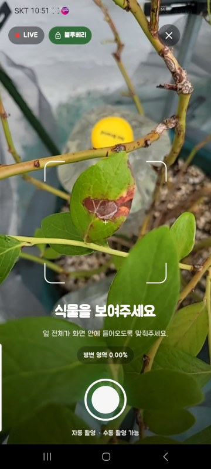
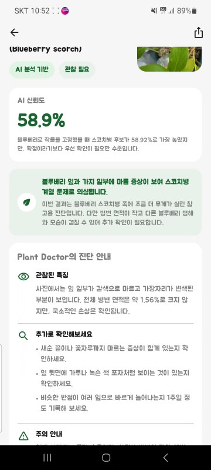
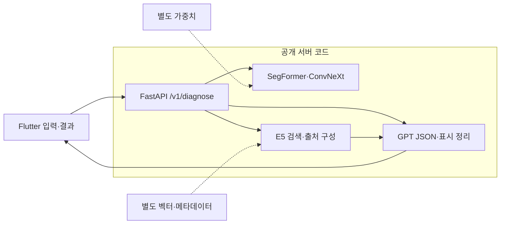
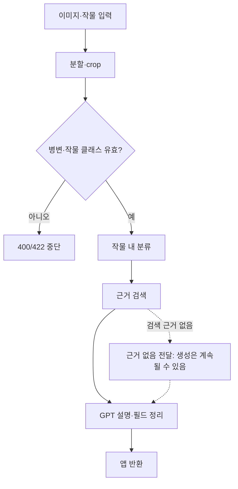

# 잎파라치 - AI 식물 질병 진단 보조 앱

잎 사진에서 병변을 찾고, 선택한 작물 안에서 질병 후보를 좁힌 뒤 공공 농업 자료와 함께 설명하는 개인 프로젝트입니다. 데이터 정제·모델 학습부터 FastAPI 서버와 Flutter 앱까지 연결했습니다.

**현재 범위:** Flutter 모바일 프로토타입과 공개 추론 코드입니다. 모델 가중치·원본 이미지·RAG 인덱스는 별도이며 clone만으로 전체 추론을 실행할 수 없습니다.


[빠른 실행](#빠른-실행) · [결과](#결과) · [문제](#문제정의) · [구조](#아키텍처) · [상세 흐름](#상세-워크플로우) · [데이터](#데이터) · [시도](#시도와-개선) · [평가](#평가와-재현) · [한계](#한계) · [기여](#기여와-ai-활용)

## 빠른 실행

Python 3 환경에서 저장소 루트의 **모델 없는 코드 계약 검사**부터 실행할 수 있습니다. Python 표준 라이브러리만 사용하며 외부 API·GPU를 호출하지 않습니다.

```console
python evaluation/contract-v1/run.py
```

2026-11-15 재실행은 **38/38 통과, 종료 0**입니다. 실제 `app.py`에서 네 함수를 추출해 검사하며 FastAPI 서버·분할·분류·검색·GPT 실행은 포함하지 않습니다. [평가셋](evaluation/contract-v1/cases.json), [추가 회귀](evaluation/contract-v1/regression-cases.json), [이번 실행 결과](evaluation/contract-v1/results.json)

전체 서버는 `src/backend/requirements.txt`와 `.env.example`을 기준으로 환경을 준비하고 모델·인덱스·API 키를 별도로 배치해야 합니다. 설정 후 `src/backend`에서 `python -m uvicorn app:app --host 0.0.0.0 --port 8001`로 실행하고 `/health`의 자산 준비 상태를 확인합니다. [앱·서버 설치와 휴대폰 연결](docs/APP_AND_SERVER.md)

## 결과

| 입력·확인 단계 | 사용자가 받는 결과 | 실제 근거 |
|---|---|---|
| 사진과 작물 선택 | 병변 마스크, 질병 후보, 작물 내 재정규화 확률 | [진단 API](src/backend/app.py) |
| 근거 검색과 설명 | 증상·관리 설명과 출처 목록 | [모바일 결과 화면](src/mobile/lib/screens/diagnosis_result_screen.dart) |
| 빈 사진·병변 없음·미지원 작물 | 오류로 중단, 다른 작물의 병으로 대체하지 않음 | `diagnose`, `constrain_predictions_to_host` |

| 촬영·입력 | 분석·결과 |
|---|---|
|  |  |

[기존 약 61초 시연 영상](https://raw.githubusercontent.com/Engineer3rd-Class-Kimmin/Plant_Doctor/main/assets/demo/plant-doctor-demo.mp4). 위 화면과 영상은 기존 시연 자료이며 이번 문서 작업의 새 모바일 E2E가 아닙니다.

## 문제정의

잎 전체를 바로 분류하면 배경이나 정상 조직이 판단에 섞이고, 비슷한 병징 때문에 다른 작물의 병이 후보로 나올 수 있었습니다. 분류 확률만으로 관리 방법까지 설명하면 이미지 모델의 오판이 근거 없는 안내로 이어질 수 있었습니다. 그래서 병변을 먼저 분리하고, 사용자가 고른 작물과 설명의 출처를 별도로 확인하도록 구성했습니다.

## 아키텍처



| 책임 | 코드 | 구현·자산 경계 |
|---|---|---|
| 분할·crop·분류·작물 제한 | [app.py](src/backend/app.py) | 공개 코드, 모델은 별도 |
| 검색·출처·생성 | `RagVectorStore`, `load_rag_facts`, `summarize_diagnosis_with_gpt` | 앱은 E5 내적 검색. 연구 하네스와 구분 |
| 촬영·API·결과 표시 | [Flutter](src/mobile/lib) | PC 서버 주소·네트워크 연결 필요 |

[시스템 설계](docs/ARCHITECTURE.md) · [연구 검색과 앱 경로의 차이](docs/RAG_PIPELINE.md)

## 상세 워크플로우



| 단계 | 실제 처리와 입출력 | 확인할 코드 |
|---|---|---|
| 1. 입력 | 앱이 사진과 `host`, `host_ko`, `locale`를 전송합니다. 빈 파일은 400, 읽을 수 없는 이미지는 입력 오류로 처리합니다. | [모바일 코드](src/mobile/lib), [diagnose·open_rgb](src/backend/app.py) |
| 2. 병변 분리 | `run_segmentation`으로 마스크와 면적 비율을 구하고 `build_focus_crop`으로 분류용 이미지를 만듭니다. 병변이 없으면 후속 진단을 중단합니다. | [분할·crop 함수](src/backend/app.py) |
| 3. 질병 후보 | 분류 전체 확률을 구한 뒤 선택 작물의 클래스만 남깁니다. 해당 클래스가 없으면 다른 작물로 바꾸지 않습니다. 이때 표시 확률은 작물 안에서 재정규화된 값입니다. | [run_classifier·constrain_predictions_to_host](src/backend/app.py) |
| 4. 근거 검색 | 작물과 최상위 질병 후보를 질의로 만들고 E5 벡터 내적으로 검색합니다. 점수 하한과 작물 조건을 통과한 근거를 최대 `RAG_TOP_K`개 선택합니다. | [RagVectorStore.search](src/backend/app.py) |
| 5. 설명 생성 | 이미지·마스크 통계·후보·검색 근거를 GPT에 전달합니다. JSON 해석, 기본 필드 보완, 목록 길이와 언어 정리를 거쳐 앱에 반환합니다. | [load_rag_facts·summarize_diagnosis_with_gpt](src/backend/app.py) |
| 6. 표시 | 앱은 결과와 출처를 보여줍니다. `/v1/segment`의 마스크 표시와 질병 사전·날씨는 별도 API 경로입니다. | [서버 API](src/backend/app.py), [날씨 라우터](src/backend/weather_api.py) |

### 실패와 근거 부족은 어떻게 다루나

빈 이미지·병변 없음·미지원 작물은 성공 결과로 바꾸지 않고 오류를 반환합니다. 모델이나 벡터가 준비되지 않으면 진단을 실행할 수 없으므로 먼저 `/health`에서 준비 상태를 확인해야 합니다. GPT 연결 실패 시 완전한 진단을 보장하는 독립 대체 경로는 없습니다.

검색 결과가 비면 프롬프트에 `사용 가능한 RAG 근거 없음`을 전달하지만 설명 생성 자체는 계속될 수 있습니다. 기본 관리 문구도 코드에 포함되어 있어 **반환된 모든 문장이 개별 출처로 자동 검증됐다고 볼 수 없습니다.** 이 부분은 추가 근거 검증이 필요한 한계입니다.

## 데이터

| 자료 | 역할·범위 | 공개·검증 경계 |
|---|---|---|
| PlantSeg | 병변 이미지·마스크, 분할·분류 | 원본 별도. 비정상 빈 마스크 16건 제외 |
| PlantWild healthy | 정상 잎 hard negative | 빈 마스크 4,000건은 정상 정답이며 오류가 아님 |
| 24개 작물·62개 클래스 | 제품의 분류 범위 | 분류 요약의 학습 4,578장·검증 1,117장 |
| 농사로/NCPMS·병명 목록 등 | 증상·관리·병명 근거 | 출처·메타데이터 감사와 답변 사실성은 별개 |
| 38,697개 768차원 벡터 | 앱 검색 인덱스 | 벡터 본체·모델은 공개본에 없음 |

[데이터·공개 범위·한계](docs/DATA_AND_LIMITATIONS.md) · [분류 요약](evidence/classification/summary.json) · [RAG 출처 감사](evidence/rag/source_audit_summary.json)

## 시도와 개선

| 겪은 문제 | 선택한 해결 방법 | 확인한 것과 남은 한계 |
|---|---|---|
| 배경·정상 조직을 병변으로 오인 | 분할 후 crop 분류, 정상 잎 hard negative와 촬영 환경 증강 | [분할 지표](evidence/segmentation/best_metrics.json)를 남겼지만 정상 잎 오탐과 현장 분포 차이는 남음 |
| 다른 작물의 질병 후보가 섞임 | 사용자 작물 선택과 classifier host 제약 | 복합 작물명 절단을 수정하고 경계 회귀를 추가. 작물 내 확률은 확정 진단 정확도가 아님 |
| 설명의 근거를 추적하기 어려움 | 청크·본문 해시·출처·작물 메타데이터를 보존하고 검색에 연결 | [출처 감사](evidence/rag/source_audit_summary.json)는 무결성 검사이며 답변 사실성 평가와 다름 |
| 연구 실험과 앱 실행 경로가 다름 | 연구용 다중 질의·RRF·BGE 재정렬과 앱의 E5 검색을 구분 | [RAG 문서](docs/RAG_PIPELINE.md)의 연구 절차 전체가 공개 앱에서 실행되는 것은 아님 |

## 평가와 재현

| 검증 | 데이터·조건 | 결과와 근거 | 해석 범위 |
|---|---|---|---|
| 기존 분할 | PlantSeg 원본 테스트 | Dice 80.26%, IoU 67.03% · [JSON](evidence/segmentation/best_metrics.json) | 이번 작업에서 새 추론하지 않음 |
| 기존 분류 | best epoch 21의 검증셋 | Top-1 82.72%, Top-3 93.11% · [평가 조건](docs/MODEL_EVALUATION.md) | 농가 독립 외부 검증 아님 |
| 공개 코드 계약 재실행 | 기존 23개+추가 회귀 15개, 실제 소스 함수 | 2026-11-15 **38/38** · [결과](evaluation/contract-v1/results.json), [사례표](evaluation/contract-v1/RESULTS.md) | 모델·RAG·API·모바일 E2E와 합산하지 않음 |

코드 계약의 수정 전 22/23 결과와 원래 입력은 [baseline](evaluation/contract-v1/baseline/RESULTS.md)에 보존했습니다. 실행기·입력·제품 코드 해시와 Python 버전은 결과 JSON에 있습니다. 개발 회귀이며 독립 블라인드 평가가 아닙니다.

## 원본과 공개본 대조

남아 있는 원본 서버와 공개 서버의 주요 정의 7개를 AST로 대조했습니다. 진단·분할·검색·GPT 요약 등을 포함한 6개는 같고, `label_host`는 달랐습니다. 공개본의 복합 작물명 수정이 원본 실행 서버에도 반영됐다고 볼 수는 없습니다. 따라서 위 38/38은 공개본 코드에 대한 결과입니다. 원본의 분류 요약·학습 이력은 공개 증거 파일과 바이트가 같았으며, 분할 지표는 대응 원본 파일을 찾지 못해 공개 증거 기준으로만 제시했습니다.

## 한계

| 한계 | 사용자 영향 | 현재 대응·다음 확인 |
|---|---|---|
| 근거가 없거나 기본 문구가 사용됨 | 모든 생성 문장이 개별 출처로 검증된 것은 아님 | 근거 없음 표시·추가 사실 검증 필요 |
| 분포 밖 질병·복합 감염·초기 병징 | 후보와 설명이 틀릴 수 있음 | 작물 제한·전문가 확인 안내 |
| 가중치·원본·인덱스 별도 | clone만으로 전체 실행 불가 | 자산과 출처별 이용 조건을 준비해야 함 |
| 작물 내 재정규화 확률 | 확정 진단 정확도로 오해할 수 있음 | 후보 보조 지표로 설명 |

빈 이미지·병변 없음·지원되지 않는 작물은 중단합니다. GPT 연결 실패를 보장된 독립 진단 경로로 대신하지 않습니다. 실제 방제는 전문가·등록 약제 정보와 함께 확인해야 합니다.

## 기여와 AI 활용

데이터 정제·증강, 모델 학습·평가, RAG, API, Flutter와 통합 작업을 개인 프로젝트로 수행했습니다. 제품에는 비전 모델·임베딩·GPT를 사용하고, 코드 보완·회귀·이번 문서 정리에는 AI 코딩 도구를 활용했습니다(ai-assisted). 모델 출력, 출처 감사, 코드 계약을 각각 검증했으며 모든 단계의 독립 전문가 검수가 완료된 것은 아닙니다. [개인 기여와 검증 범위](docs/APPLICATION_PORTFOLIO.md)에 근거를 연결했습니다.

## 상세 문서와 이전 기록

[개발 과정](docs/DEVELOPMENT_JOURNEY.md) · [모델 평가](docs/MODEL_EVALUATION.md) · [실행 안내](docs/APP_AND_SERVER.md) · [개인 기여](docs/APPLICATION_PORTFOLIO.md)

[이전 README 전체 기록](README_HISTORY.md)은 기존 시연·설치·기술 스택·기능별 기록과 측정 조건을 보존한 스냅샷입니다. 현재 실행 경계와 새 문서의 기준은 위 본문을 따릅니다. 이번 변경은 공개 코드·문서·평가 대조에 AI 코딩 도구를 사용했습니다(ai-assisted). 자동 병합하지 않습니다.
