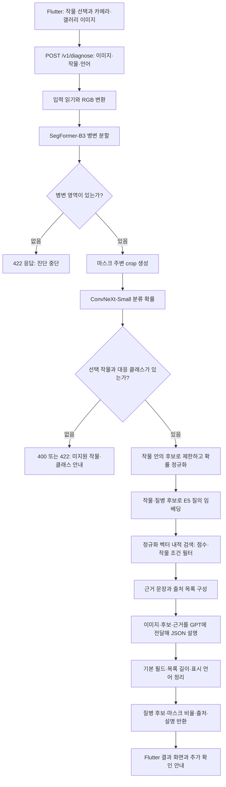
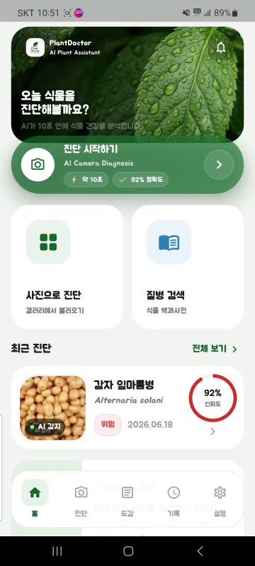
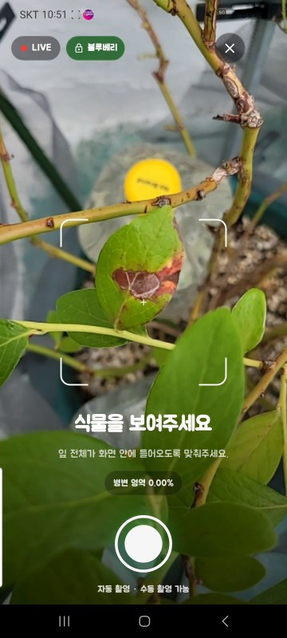
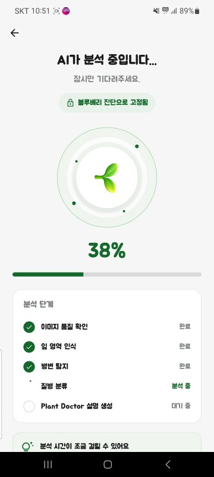
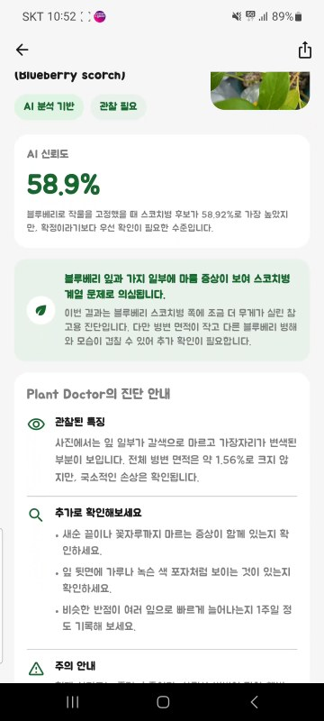
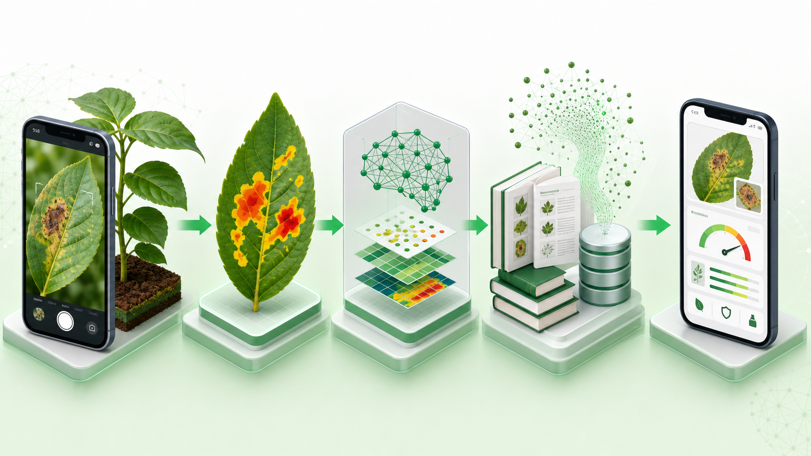
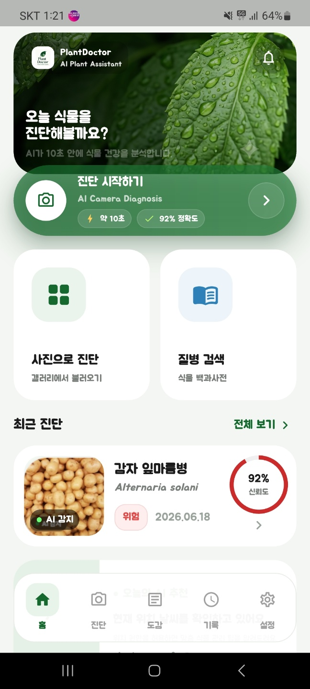
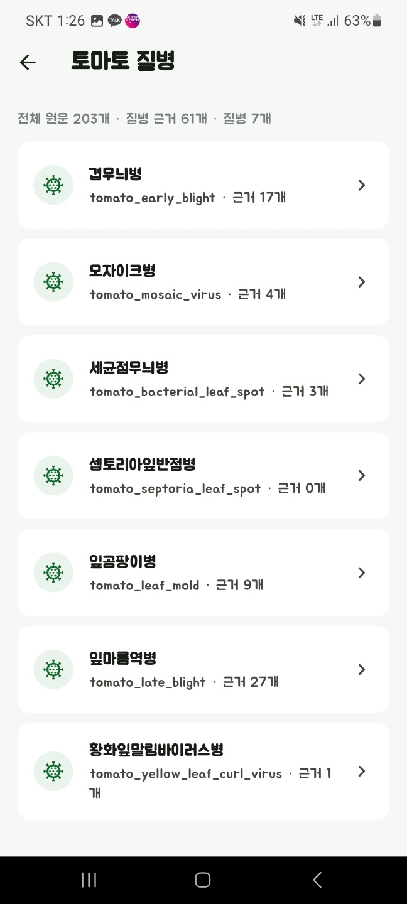
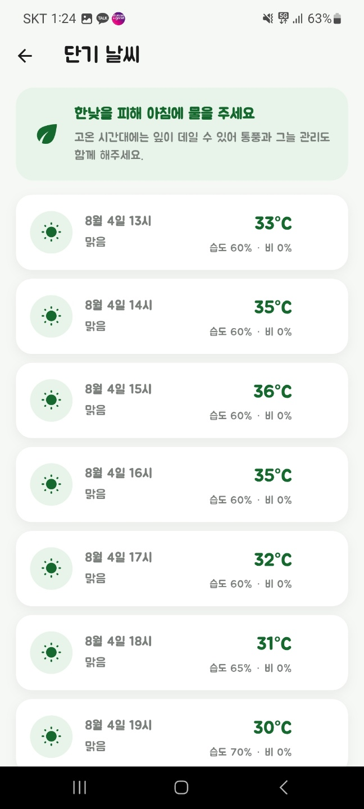

# 잎파라치 - AI 식물 질병 진단 보조 앱

잎 사진에서 병변을 찾고, 선택한 작물 안에서 질병 후보를 좁힌 뒤 공공 농업 자료와 함께 설명하는 개인 프로젝트입니다. 데이터 정제·모델 학습부터 FastAPI 서버와 Flutter 앱까지 연결했습니다.

**현재 범위:** 모바일 프로토타입과 공개 추론 코드가 있습니다. 모델 가중치·원본 데이터·RAG 벡터는 별도 자산입니다. 아래 도식은 공개 `src/backend/app.py`의 실행 경로이며, 연구용 검색 하네스와 구분합니다.

[실행 워크플로우](#실행-워크플로우) · [문제와 해결 과정](#문제와-해결-과정) · [결과와 한계](#결과와-한계) · [시연 영상](https://raw.githubusercontent.com/Engineer3rd-Class-Kimmin/Plant_Doctor/main/assets/demo/plant-doctor-demo.mp4) · [설치와 실행](#로컬-실행)

## 어떤 문제였나

잎 전체를 바로 분류하면 배경이나 정상 조직이 판단에 섞이고, 비슷한 병징 때문에 다른 작물의 병이 후보로 나올 수 있었습니다. 분류 확률만으로 관리 방법까지 설명하면 이미지 모델의 오판이 근거 없는 안내로 이어질 수 있었습니다. 그래서 병변을 먼저 분리하고, 사용자가 고른 작물과 설명의 출처를 별도로 확인하도록 구성했습니다.

## 실행 워크플로우



| 단계 | 실제 처리와 입출력 | 확인할 코드 |
|---|---|---|
| 1. 입력 | 앱이 사진과 `host`, `host_ko`, `locale`를 전송합니다. 빈 파일은 400, 읽을 수 없는 이미지는 입력 오류로 처리합니다. | [모바일 코드](src/mobile/lib), [diagnose·open_rgb](src/backend/app.py) |
| 2. 병변 분리 | `run_segmentation`으로 마스크와 면적 비율을 구하고 `build_focus_crop`으로 분류용 이미지를 만듭니다. 병변이 없으면 후속 진단을 중단합니다. | [분할·crop 함수](src/backend/app.py) |
| 3. 질병 후보 | 분류 전체 확률을 구한 뒤 선택 작물의 클래스만 남깁니다. 해당 클래스가 없으면 다른 작물로 바꾸지 않습니다. 이때 표시 확률은 작물 안에서 재정규화된 값입니다. | [run_classifier·constrain_predictions_to_host](src/backend/app.py) |
| 4. 근거 검색 | 작물과 최상위 질병 후보를 질의로 만들고 E5 벡터 내적으로 검색합니다. 점수 하한과 작물 조건을 통과한 근거를 최대 `RAG_TOP_K`개 선택합니다. | [RagVectorStore.search](src/backend/app.py) |
| 5. 설명 생성 | 이미지·마스크 통계·후보·검색 근거를 GPT에 전달합니다. JSON 해석, 기본 필드 보완, 목록 길이와 언어 정리를 거쳐 앱에 반환합니다. | [load_rag_facts·summarize_diagnosis_with_gpt](src/backend/app.py) |
| 6. 표시 | 앱은 결과와 출처를 보여줍니다. `/v1/segment`의 마스크 표시와 질병 사전·날씨는 별도 API 경로입니다. | [서버 API](src/backend/app.py), [날씨 라우터](src/backend/weather_api.py) |

### 실패와 근거 부족은 어떻게 다루나

빈 이미지·병변 없음·미지원 작물은 성공 결과로 바꾸지 않고 오류를 반환합니다. 모델이나 벡터가 준비되지 않으면 진단을 실행할 수 없으므로 먼저 `/health`에서 준비 상태를 확인해야 합니다. GPT 연결 실패 시 완전한 진단을 보장하는 독립 대체 경로는 없습니다.

검색 결과가 비면 프롬프트에 `사용 가능한 RAG 근거 없음`을 전달하지만 설명 생성 자체는 계속될 수 있습니다. 기본 관리 문구도 코드에 포함되어 있어 **반환된 모든 문장이 개별 출처로 자동 검증됐다고 볼 수 없습니다.** 이 부분은 추가 근거 검증이 필요한 한계입니다.

## 문제와 해결 과정

| 겪은 문제 | 선택한 해결 방법 | 확인한 것과 남은 한계 |
|---|---|---|
| 배경·정상 조직을 병변으로 오인 | 분할 후 crop 분류, 정상 잎 hard negative와 촬영 환경 증강 | [분할 지표](evidence/segmentation/best_metrics.json)를 남겼지만 정상 잎 오탐과 현장 분포 차이는 남음 |
| 다른 작물의 질병 후보가 섞임 | 사용자 작물 선택과 classifier host 제약 | 복합 작물명 절단을 수정하고 경계 회귀를 추가. 작물 내 확률은 확정 진단 정확도가 아님 |
| 설명의 근거를 추적하기 어려움 | 청크·본문 해시·출처·작물 메타데이터를 보존하고 검색에 연결 | [출처 감사](evidence/rag/source_audit_summary.json)는 무결성 검사이며 답변 사실성 평가와 다름 |
| 연구 실험과 앱 실행 경로가 다름 | 연구용 다중 질의·RRF·BGE 재정렬과 앱의 E5 검색을 구분 | [RAG 문서](docs/RAG_PIPELINE.md)의 연구 절차 전체가 공개 앱에서 실행되는 것은 아님 |

## 결과와 한계

| 기록된 결과 | 읽는 방법 |
|---|---|
| B3 Dice 80.26%, IoU 67.03% | 기존 PlantSeg 평가 결과. 이번 README 작업에서 새 추론하지 않음 |
| Small Top-1 82.72%, Top-3 93.11% | 기존 검증셋 결과. 독립 농가 외부 테스트가 아님 |
| 공개 코드 계약 38/38 | 문자열·작물명·JSON 처리 회귀. 모델·RAG·모바일 E2E 점수와 합산하지 않음 |

24개 작물·62개 분류 클래스 범위 밖의 질병, 복합 감염, 영양 결핍, 초기 병징에는 한계가 있습니다. 모델·원본 이미지·RAG 인덱스가 공개본에 없으므로 clone만으로 전체 AI 추론을 재현할 수 없습니다. [평가 조건](docs/MODEL_EVALUATION.md), [코드 계약 결과](evaluation/contract-v1/RESULTS.md), [데이터와 한계](docs/DATA_AND_LIMITATIONS.md)를 함께 확인할 수 있습니다.

## 개인 기여와 AI 활용

데이터 정제·증강, 모델 학습·평가, RAG, API, Flutter와 통합 작업을 개인 프로젝트로 수행했습니다. 제품에는 비전 모델·임베딩·GPT를 사용하고, 코드 보완·회귀·이번 문서 정리에는 AI 코딩 도구를 활용했습니다(ai-assisted). 모델 출력, 출처 감사, 코드 계약을 각각 검증했으며 모든 단계의 독립 전문가 검수가 완료된 것은 아닙니다. [개인 기여와 검증 범위](docs/APPLICATION_PORTFOLIO.md)에 근거를 연결했습니다.

---

<details>
<summary>시연·설치·기술 스택·기존 상세 기록 펼치기</summary>

문제·개인 기여·AI 활용과 검증 범위는 [지원용 프로젝트 설명](docs/APPLICATION_PORTFOLIO.md)에 정리했습니다. 신규 공개 코드 계약 평가는 **기존 23/23·추가 회귀 15/15, 총 38/38 통과**이며 [입력별 결과와 재현 방법](evaluation/contract-v1/RESULTS.md)을 공개합니다. 기존 모델 정확도와는 별도 평가입니다.


> 컴퓨터 비전 기반 식물 질병 진단부터 RAG 기반 설명 생성, FastAPI 추론 서버, Flutter 모바일 앱까지 직접 구축한 End-to-End AI 서비스 프로젝트

이 저장소는 데이터 조사부터 모델 학습, RAG 구축, FastAPI 서버, Flutter 앱까지 **혼자 설계하고 구현한 개인 프로젝트**를 포트폴리오 형태로 정리한 것입니다. 발표자료의 역할 분담 표는 초기 공모 문서의 형식이며, 이 저장소에 정리한 개발 작업은 모두 개인 수행 내용입니다.

## 시연 영상

[▶ 약 61초 전체 시연영상 바로 보기 (MP4, 28.3MB)](https://raw.githubusercontent.com/Engineer3rd-Class-Kimmin/Plant_Doctor/main/assets/demo/plant-doctor-demo.mp4)

| 앱 실행 | 실시간 촬영 | AI 분석 | 근거 기반 결과 |
|---|---|---|---|
|  |  |  |  |

## 기술 스택

| 영역 | 기술 |
|---|---|
| AI / Vision | Python · PyTorch · SegFormer-B3 · ConvNeXt-Small · Transformers |
| RAG / LLM | multilingual-e5-base · BGE Reranker · OpenAI API · NumPy Vector Search |
| Backend | FastAPI · Uvicorn · Pillow/HEIF |
| Mobile | Flutter · Dart · Android |
| Evaluation | Dice · IoU · Recall · Top-1 · Top-3 · Macro Recall · provenance audit |



## 한눈에 보기

```text
카메라/갤러리 이미지
        ↓
SegFormer-B3 (병변 분할)
        ↓ 병변 crop + mask
ConvNeXt-Small (질병 후보 분류)
        ↓ host-constrained 후보
Vector RAG (공공 농업 근거 검색)
        ↓ 근거와 출처
GPT 기반 구조화·검증
        ↓
Flutter 앱 결과 화면
```

| 구분 | 구현 내용 |
|---|---|
| 대상 | 24개 작물 범위, 62개 질병 분류 클래스 |
| 병변 분할 | SegFormer-B3, 병변/배경 이진 분할 |
| 질병 분류 | ConvNeXt-Small, 작물(host) 제약 후보 검색 |
| 지식 검색 | multilingual-e5-base, 38,697개 768차원 정규화 벡터 |
| 생성·검증 | 검색 근거 기반 2단계 LLM 생성, 필드·인용 검사 및 재생성 |
| 서비스 | FastAPI 서버 + Flutter Android 앱 |
| 부가 기능 | 실시간 마스크, 사진 진단, 질병 사전, 날씨·농업 가이드, 다국어 UI |

## 최종 모델 성능

| 모델 | 평가 지표 | 결과 |
|---|---|---:|
| SegFormer-B3 | Dice | **80.26%** |
| SegFormer-B3 | IoU | **67.03%** |
| SegFormer-B3 | Recall | **82.65%** |
| ConvNeXt-Small | Top-1 Accuracy | **82.72%** |
| ConvNeXt-Small | Top-3 Accuracy | **93.11%** |
| ConvNeXt-Small | Macro Recall | **81.72%** |

SegFormer 수치는 PlantSeg 원본 테스트 기준입니다. 분류기는 best epoch 21 기준입니다. 과거 B2/Tiny 실험은 데이터 구성과 평가 프로토콜이 달라 최종 모델과 직접 비교하지 않았습니다. 세부 조건은 [모델 및 평가](docs/MODEL_EVALUATION.md)를 참고하십시오.

## 문제를 어떻게 풀었는가

1. 전체 잎을 바로 분류하면 배경과 정상 조직이 판단을 방해한다고 보았습니다.
2. 먼저 병변만 분할하고 병변 영역을 중심으로 분류하는 2단계 비전 구조를 만들었습니다.
3. 사진 한 장만으로 확정 진단하는 위험을 줄이기 위해 사용자가 작물을 먼저 선택하도록 했습니다.
4. 분류 확률을 그대로 설명으로 바꾸지 않고, 공공 농업 자료를 벡터 검색한 뒤 근거가 있는 내용만 생성하도록 했습니다.
5. 실내 데이터와 실제 촬영 환경의 차이를 줄이기 위해 회전, 밝기, 역광, 그림자, 블러, 압축 노이즈 등을 대량 증강했습니다.
6. 카메라부터 서버 응답, 결과 화면까지 하나의 앱 흐름으로 통합했습니다.

## 주요 문서

- [개발 과정과 문제 해결](docs/DEVELOPMENT_JOURNEY.md)
- [시스템 아키텍처](docs/ARCHITECTURE.md)
- [RAG 구축 방식](docs/RAG_PIPELINE.md)
- [데이터와 모델 평가](docs/MODEL_EVALUATION.md)
- [앱·서버 구성과 실행](docs/APP_AND_SERVER.md)
- [제품 가치와 확장 로드맵](docs/PRODUCT_AND_ROADMAP.md)
- [데이터·공개 범위·한계](docs/DATA_AND_LIMITATIONS.md)
- [면접/발표용 질문과 답변](docs/INTERVIEW_QA.md)

## 앱 화면

| 홈 | 질병 사전 | 날씨 가이드 |
|---|---|---|
|  |  |  |

## 저장소 구성

```text
.
├─ README.md
├─ assets/demo/            # Android 실기기 시연영상과 대표 프레임
├─ docs/                 # 설계, 실험, RAG, 회고, 발표용 설명
├─ src/
│  ├─ backend/           # FastAPI 추론·RAG 서버
│  ├─ mobile/            # Flutter 앱의 lib 및 프로젝트 설정
│  └─ research/          # 대표 학습·평가·RAG 구축 스크립트
├─ evidence/             # 재현 가능한 지표·인덱스 메타데이터
└─ assets/               # 포트폴리오 이미지
```

## 로컬 실행

먼저 저장소를 내려받고 백엔드 환경을 준비합니다.

```bash
git clone https://github.com/Engineer3rd-Class-Kimmin/Plant_Doctor.git
cd Plant_Doctor/src/backend
python -m venv .venv
```

Windows PowerShell:

```powershell
.\.venv\Scripts\python.exe -m pip install -r requirements.txt
Copy-Item .env.example .env
.\.venv\Scripts\python.exe -m uvicorn app:app --host 0.0.0.0 --port 8001
```

macOS/Linux:

```bash
./.venv/bin/python -m pip install -r requirements.txt
cp .env.example .env
./.venv/bin/python -m uvicorn app:app --host 0.0.0.0 --port 8001
```

`.env`에서 모델 checkpoint와 RAG 인덱스 경로, API 키를 설정한 뒤 실행해야 합니다. 모델 가중치와 RAG 원문·벡터 본체는 용량 및 데이터 배포 조건 때문에 GitHub에 포함하지 않았으므로, 공개 저장소만 복제한 상태에서는 전체 AI 추론을 재현할 수 없습니다. 필요한 파일 구조는 [.env.example](src/backend/.env.example)에서 확인할 수 있습니다.

서버가 준비되면 다음 주소로 로딩 상태를 확인합니다.

```text
http://127.0.0.1:8001/health
```

PowerShell 실행 정책으로 `Activate.ps1`이 막히더라도 위 예시처럼 가상환경의 `python.exe`를 직접 호출하면 됩니다.

## 공개 저장소 주의사항

- `.env`, API 키, 개인 인증정보는 포함하지 않았습니다.
- 모델 가중치, 원본 데이터셋, RAG 원문/벡터 본체, APK는 포함하지 않았습니다.
- 이 시스템은 의사결정 보조 도구이며 전문가의 현장 진단을 대체하지 않습니다.
- 데이터셋과 공공 자료의 원저작권·이용 조건은 각 제공처에 따릅니다.
- 아직 오픈소스 라이선스를 선택하지 않았습니다. 공개 재사용을 허용하려면 업로드 전에 라이선스를 별도로 선택해야 합니다.

---

**개인 기여 범위:** 문제 정의 · 데이터 분석/정제 · 학습 파이프라인 · 증강 · 모델 평가 · RAG 수집/정제/임베딩/검색 · LLM 검증 흐름 · API · Flutter 앱 · 통합 테스트 · 발표자료 정리

</details>
